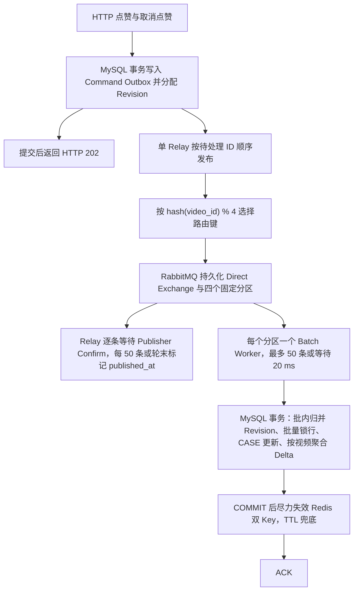

# GoFeed 亮点二最终冻结报告

基线包含正式 S3 提交 `c07498f` 和 A2-1 提交 `e90f3c0`。本次复用已完成的性能实验，并以最终代码执行关键业务回归和工程检查。

## 最终架构

### 可靠命令受理

客户端的 `request_id` 与账号共同确定请求身份。同一个请求重复到达时返回原命令，对相同 ID 的不同意图返回冲突。MySQL 在同一事务中分配服务端 Revision 并写入 Outbox。HTTP 202 表示意图已经持久化。单 Relay 保留持久投递、Mandatory、Confirm 和 Return 检查。只批量标记已确认的 ID，标记失败可用原消息身份重投。

### 异步批量处理

按 `video_id` 路由使同一个视频的计数更新集中在一个消费者，减少多个分区争用同一视频行。批内按账号和视频保留最高 Revision，经现有唯一复合索引批量锁定关系，使用 CASE 更新并按真实状态变化聚合 Delta。过期或重复投递跳过，状态相同只推进 Revision。关系和视频计数在同一事务提交，零净 Delta 跳过计数写入。

### 缓存一致性

COMMIT 后失效详情 Key 和 Feed 实体 Key，再 ACK。Redis 失效失败时由 60 秒 Redis TTL 兜底，Feed 实体还有既有的 5 秒进程缓存。关注页整页缓存允许计数短暂陈旧，已应用点赞状态在读取时查询。TTL 是缓存的存活配置，采样所得陈旧窗口受观测间隔与并发回填影响。

## 哪些结论有实验支持

- **A2-1** 在 mixed 50 HTTP RPS 的一次基线与一次优化对照中，Relay 活跃发布由 31.08 升至 84.21 条每秒，标记 SQL 由 1,351 降至 32 次，Outbox 峰值由 529 降至 103。优化轮新增 1,350 条命令全部 ACK，停压后 3.23 秒确认排空。84.21 是 Relay 非空轮次的速率。HTTP P99 从 68.60 升至 119.40 ms，单次对照无法归因。这些结果支持本项目 50 RPS 的受理目标，容量上限和 HTTP 尾延迟仍未确定。 [A2 验收记录](GoFeed_A2批量标记验收.md)
- **S3** 复用 36 轮 SQL × 分区对照。相对 S0，uniform、Zipf、单热点的显式 SQL/ACK 分别从 2.989、2.798、2.053 降至 2.268、1.095、0.089。单热点 60,000 条全部进入一个分区，历史采样的行锁等待中位数由 3,203 降至 0，事务 P95 由 93.36 降至 28.73 ms。正式版三个代表场景全部通过在线和独立离线对账。该结果验证了已测负载下的 SQL 降本与热点竞争改善，单分区的容量上限仍未测定。 [S3 验收记录](GoFeed_S3正式落地验收.md)
- **缓存** 保留双 Key。历史双 Key 的热点 Feed 陈旧 P95 上界估计约 6.18 秒。统一 Key 在正式复测的回源量基本持平。静态与计数拆分采用 1 秒 TTL 时，热点回源中位数由 405 降到 58，分散的读多写少场景从 2,230 增到 5,277。拆分对热点有收益，但额外读取与回源代价取决于工作负载。正式版复用已验证的双 Key 失效和 TTL。

## 关键业务回归

| 路径 | 实测结果 |
|---|---|
| 视频及展示 | 发布两条视频，详情与最新流返回正确视频。核对响应中的 `is_liked`、`likes_count` 与 MySQL，关注流和热门流返回的对应状态与计数正确。前端沿用现有字段绑定，本轮回归以实际 HTTP 响应为准。 |
| 点赞 | 点赞、取消、同 RequestID 重试、不同 RequestID 的同目标操作及快速连续切换通过。重复取消保持 0，最后一条 Revision 对应的计数为 1。九条唯一命令全部标记，四个分区 Ready 和 Unacked 归零。 |
| 评论 | 创建、列表计数及删除通过，列表从 0 到 1 再到 0。发现原 Comment Worker 用两个独立 SQL 提交评论及 MySQL 热度，后者故障重试会留下重复评论。修复为共享事务并沿用原有重试。真实 MySQL 注入热度写入失败，第一笔评论回滚，解除故障后重试仅插入一条，点赞计数始终为 1。 |
| 关注 | 八个并发关注只有一个成功，MySQL 唯一键保护关系。重复关注保持一条，粉丝数和关注数各为 1。取消后两者归零，关注流刷新；实现无需修改。 |
| 热榜 | 现有点赞榜按 `likes_count` 排序，热榜读取 Redis 滚动热度，空榜可读 MySQL 热度。点赞和取消点赞正确更新计数，保持正式版热度口径。评论使 Redis 窗口和 MySQL 热度各增加一次，热门流返回对应视频及当前点赞状态。热榜实现无需修改。 |

回归使用独立 MySQL 8.0.46、RabbitMQ 3.13.7 和 Redis 7.4.11，运行真实 API 与 Worker。首次故障注入因 MySQL 客户端语句分隔符配置在执行前中断，调整脚本后从已验证的点赞状态继续，已通过的业务步骤未重跑。评论删除移除评论记录，现有热度仍记录已发生互动。评论数按详情评论列表核对。

最终全量只执行一轮。常规和 Race 测试均启用真实集成用例。`go test -count=1 ./...`、`go test -race -count=1 ./...`、`go vet ./...`、`go build ./...` 与 `git diff --check` 全部通过。

## 面试说明与冻结决定

- **怎么解释 202 和重复投递？** 202 表示意图已提交，UI 可以乐观展示。发布标记失败或 COMMIT 后 ACK 失败都可能重投，关系 Revision 让重放不产生第二次计数。
- **为什么把同视频路由到同一个分区？** 计数行以视频为单位，按视频归属消费者可以压低同一热点行的竞争。跨视频仍由四个分区并行处理。批量 SQL 进一步减少关系操作。
- **为什么没有继续优化？** 50 RPS 受理与最终排空已经验证。当前工作量下，多 Relay 或更复杂的 Worker 会引入额外协调成本，现有实验不足以证明需要承担这些成本。
- **为什么深入点赞？** 点赞高频且热点集中，适合验证乱序处理、幂等和批处理。评论和关注的写入语义与竞争特征不同，评论事务修复即可解决这次发现的部分提交问题。
- **为什么到此冻结？** 项目面向本科后端求职，目标是展示从业务问题、并发控制到实验验证的闭环。继续扩展生产级架构的边际收益已经较低。

**亮点二正式冻结，不再继续扩展。**
