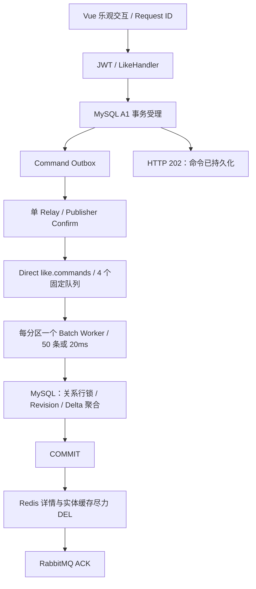

# feedsystem_video_go

> 项目介绍：本项目是一款由 Go + Vue 3 开发的短视频 Feed 流系统，提供账号、视频、点赞、评论、关注（Social）、Feed、私信与通知接口，并通过 Redis、RabbitMQ、分片上传、SSE 与 Docker Compose 提升性能、体验和部署效率。

# 技术栈

| 维度            | 组件/工具                    | 说明                                                         |
| --------------- | ---------------------------- | ------------------------------------------------------------ |
| 开发语言        | Go (Golang)                  | 后端核心业务逻辑实现（API + Worker）。                       |
| Web 框架        | Gin                          | HTTP 路由注册、参数绑定、统一返回与中间件链（JWTAuth / SoftJWTAuth）。 |
| ORM 框架        | GORM                         | 模型定义、CRUD、启动时 AutoMigrate 自动迁移表结构。          |
| 持久化          | MySQL                        | 存储 `Account / Video / Like / Comment / Social / Tag / VideoTag / Message / Notification / OutboxMsg / CommandOutbox` 等表及统计字段（如 likes_count、popularity）。 |
| 缓存/排行榜     | Redis（可选）                | Token/Refresh Token 缓存、Feed 时间线、视频实体缓存、视频详情缓存、热榜 ZSET、分片上传会话、接口限流计数。 |
| 消息队列 | RabbitMQ | 点赞命令使用持久化 Direct Exchange `like.commands` 与四个固定分区；评论、关注、热度、视频时间线沿用各自 Topic 链路。MQ 暂时不可用时，已持久化点赞命令留在 MySQL 等待投递。 |
| 异步执行 | Worker（Go） | `cmd/worker` 启动单个 LikeCommandRelay、四分区 LikeCommandBatchWorker，以及原有 CommentWorker/SocialWorker/PopularityWorker；API 进程保留视频时间线与评论/关注通知消费者。 |
| 文件存储        | Local Disk（可替换对象存储） | 视频与封面文件存放本地目录（生产可替换为 OSS/S3/MinIO）。    |
| 容器化/依赖编排 | Docker / Docker Compose      | 一键拉起 RabbitMQ 等依赖（可配合 `./start.sh`），便于本地联调与部署环境一致性。 |
| 接口调试        | Postman Collection           | `test/postman.json`：预置变量、批量跑接口与部分断言脚本。    |
| 前端            | Vue 3 + Vite + Pinia         | 前端工程 `frontend/`，通过 Vite 代理 `/api` 对接后端，提供沉浸式播放、发布、主页、私信等页面。 |
| 可观测性        | pprof / healthz              | `GET /healthz` 健康检查；本地 pprof 默认 API `localhost:6060`、Worker `localhost:6061`。 |

## 模块设计

### 用户系统

#### 表设计

#### 相关方法

| 层级              | 方法/路由                                                    | 输入 -> 输出                                   | 存储(MySQL/Redis) | 核心说明                                                     |
| ----------------- | ------------------------------------------------------------ | ---------------------------------------------- | ----------------- | ------------------------------------------------------------ |
| Handler           | POST `/account/register`                                     | `{username,password}` -> `{account}`           | MySQL ✅           | 注册账号；密码 bcrypt 哈希入库。                             |
| Handler           | POST `/account/login`                                        | `{username,password}` -> `{token,refresh_token,account_id,username}` | MySQL ✅ / Redis ✅ | 登录成功写 access token 与 refresh token；Redis 写 `account:<id>`、`account:<id>:refresh`、`refresh:<token>`。 |
| Handler           | POST `/account/refresh`                                      | `{refresh_token}` -> `{token,account_id,username}` | MySQL ✅ / Redis ✅ | Refresh Token 换取新的 access token；优先查 Redis，失败回源 MySQL。 |
| Handler           | POST `/account/changePassword`                               | `{username,old_password,new_password}` -> `{}` | MySQL ✅ / Redis ✅ | 修改密码成功后清空 token 与 refresh token，触发强制下线。 |
| Handler           | POST `/account/findByID`                                     | `{id}` -> `{account}`                          | MySQL ✅           | 按 ID 查用户。                                               |
| Handler           | POST `/account/findByUsername`                               | `{username}` -> `{account}`                    | MySQL ✅           | 按用户名查用户（前端常用保存 accountId/vloggerId）。         |
| Handler           | POST `/account/getProfile`                                   | `{account_id}` -> `{account,video_count,total_likes,follower_count,vlogger_count}` | MySQL ✅ | 用户主页聚合统计。                                           |
| Handler           | POST `/account/rename`                                       | `{new_username}` -> `{token}`                  | MySQL ✅ / Redis ✅ | 改名并**生成新 JWT**；旧 token 立即失效；更新 DB/Redis。     |
| Handler           | POST `/account/logout`                                       | `{}` -> `{}`                                   | MySQL ✅ / Redis ✅ | 清空 DB token 并删除 Redis token；旧 token 立即失效。        |
| Handler           | POST `/account/uploadAvatar`                                 | multipart `file` -> `{avatar_url}`             | Local Disk ✅ / MySQL ✅ | 支持 `.jpg/.jpeg/.png/.webp`，最大 10MB，写入 `.run/uploads/avatars/<accountID>/`。 |
| Handler           | POST `/account/updateProfile`                                | `{avatar_url,bio}` -> `{}`                     | MySQL ✅           | 更新头像 URL 与个人简介。                                    |
| Service(建议命名) | `Register/Login/Refresh/ChangePassword/FindByID/FindByUsername/GetProfile/Rename/Logout/UpdateProfile` | - | - | Access Token 15 分钟过期，Refresh Token 7 天有效；DB 存储当前有效 token，支持撤销。 |

### 视频系统

#### 表设计

#### 相关方法

| 层级              | 方法/路由                          | 输入 -> 输出                                          | 存储(MySQL/Redis) | 核心说明                                           |
| ----------------- | ---------------------------------- | ----------------------------------------------------- | ----------------- | -------------------------------------------------- |
| Handler           | POST `/video/uploadVideo`          | multipart `file` -> `{url,play_url}`                  | Local Disk ✅       | 普通视频上传，支持 `.mp4`，最大 200MB，写入 `.run/uploads/videos/<accountID>/<date>/`。 |
| Handler           | POST `/video/uploadCover`          | multipart `file` -> `{url,cover_url}`                 | Local Disk ✅       | 封面上传，支持 `.jpg/.jpeg/.png/.webp`，最大 10MB。 |
| Handler           | POST `/video/chunk/init`           | `{filename,file_size,chunk_size,total_chunks,file_hash}` -> `{upload_id,uploaded_chunks}` | Redis ✅ / Local Disk ✅ | 初始化分片上传；同一用户同一文件 hash 返回已有会话，用于断点续传。 |
| Handler           | POST `/video/chunk/upload`         | multipart `{upload_id,chunk_index,chunk_hash,file}` -> `{chunk_index}` | Redis ✅ / Local Disk ✅ | 单分片 MD5 校验后落盘到 `.run/uploads/tmp/<uploadID>/`。 |
| Handler           | POST `/video/chunk/status`         | `{upload_id}` -> `{upload_id,uploaded_chunks,total_chunks}` | Redis ✅ | 查询已上传分片，前端恢复进度。 |
| Handler           | POST `/video/chunk/complete`       | `{upload_id}` -> `{url,play_url}`                     | Redis ✅ / Local Disk ✅ | 检查分片完整后按顺序合并为 `.mp4`，清理临时文件与 Redis 会话。 |
| Handler           | POST `/video/publish`              | `{title,description,play_url,cover_url}` -> `{video}` | MySQL ✅ / Redis ✅ / MQ ✅ | JWT 保护；写视频记录与 Outbox 消息；从标题/描述提取 `#话题` 写入 `tags/video_tags`。 |
| Handler           | POST `/video/listByAuthorID`       | `{author_id}` -> `{videos[]}`                         | MySQL ✅           | 作者主页视频列表。                                 |
| Handler           | POST `/video/getDetail`            | `{id}` -> `{video_detail}`                            | MySQL ✅ / Redis ✅ | 视频详情缓存，使用互斥锁防击穿，变更时主动失效。     |
| Service(建议命名) | `UploadVideo/UploadCover/ChunkInit/ChunkUpload/ChunkStatus/ChunkComplete/Publish/ListByAuthorID/GetDetail` | - | - | `Publish` 通过事务同时写视频、Outbox 与标签关系；`GetDetail` 优先 Redis，未命中回源 MySQL 后回填。 |

### 点赞系统：A1 → A2 → B → C

MySQL 是点赞关系与总数的权威来源。接口设置目标状态，不同步应用点赞，也不直接向 RabbitMQ 发消息。

| 数据 | 字段与约束 | 作用 |
| --- | --- | --- |
| likes | 保留 id 主键、UNIQUE(video_id,account_id)、created_at；增加 status、next_revision、applied_revision、updated_at | status=1 有效，status=0 未点赞；取消点赞保留行。历史记录迁移为有效状态，两个 Revision 初始为 0，updated_at 从 created_at 回填 |
| command_outbox | id、account_id、request_id、video_id、desired_liked、revision、published_at、created_at | 独立于视频发布 Outbox；UNIQUE(account_id,request_id)，INDEX(published_at)，NULL 表示待发布 |

| 路由 | 请求/响应 | 行为 |
| --- | --- | --- |
| POST `/like/like` | `{request_id,video_id,desired_liked:true}` → 202 `{status:"accepted",request_id,command_id,revision}` | JWT 取得 account_id；检查参数与视频；A1 事务提交后返回。command_id/revision 使用十进制字符串 |
| POST `/like/unlike` | `{request_id,video_id,desired_liked:false}` → 相同受理结构 | 相同 Request ID 和内容返回原命令；内容冲突返回 409；不执行物理删除 |
| POST `/like/isLiked` | `{video_id}` → `{is_liked}` | 只认 status=1 |
| POST `/like/listMyLikedVideos` | `{}` → `{videos[]}` | 过滤有效关系，按 updated_at DESC 排序；Feed BatchGetLiked 同样过滤 status=1 |

- **A1 事务受理**：请求幂等查询；确保占位 likes 行存在且初始 status=0；锁定关系并递增 next_revision；写 Command Outbox；COMMIT 后才返回 202。并发 Request ID 冲突依赖唯一索引，失败事务回滚后重新读取原命令。202 只表示命令已持久化，不表示状态已经应用。
- **A2 Relay**：单实例，每轮查询 published_at IS NULL、按 id 升序最多 100 条；满 100 条成功后立即继续，空闲或失败时等待。逐条使用 Persistent、mandatory、Publisher Confirm；只有成功路由并收到 ACK 后才更新 published_at。发布成功但标记失败允许重发同一 command_id。
- **四分区**：持久化 Direct Exchange `like.commands`，队列 `like.commands.0`～`like.commands.3`。固定 FNV-1a 哈希 account_id/video_id 到四个分区；每分区独立 Channel、exclusive consumer、手动 ACK、Prefetch=50。
- **B 微批事务**：最多 50 条 / 等待最多 20ms；按用户视频组合保留最高 Revision。按 video_id/account_id 顺序锁定 likes；忽略 revision <= applied_revision；推进 status/applied_revision，但不修改 next_revision。只有状态改变才修改 updated_at。按视频汇总净 Delta、升序原子更新 likes_count，负数或数据库错误整体回滚。
- **C 缓存与 ACK**：事务返回计数变化的视频 ID 后，在事务外尽力 DEL 详情与实体缓存，再 ACK 全 Batch。Redis 故障不回滚 MySQL、不阻止 ACK。Redis 是可重建的 Cache-Aside 缓存，TTL 60 秒，接受短暂陈旧及并发旧值回填；不提供 Redis 强一致承诺。
- **连接恢复**：消费者组任一成员失败后取消并等待整组退出，固定等待 2 秒再重新 Dial、建 Channel、声明拓扑和 Consume。不引入多 Relay、动态分区、独立去重表或可靠缓存同步服务。
- **前端**：使用安全随机数生成 128-bit Request ID，发送前按账号/视频持久化完整请求。未知结果复用原请求；同一 pair 只允许一个未解决请求。立即乐观更新，明确拒绝时回滚；受理后暂保留显示，匹配的读取或受理满 60 秒后的新读取恢复服务器状态。未确定请求不会因显示期限被丢弃。客户端不分配 Revision，存储命名空间与过期协议隔离。

点赞通知目前不由命令链路产生，点赞不再独立触发热度增量；评论、关注及其通知保持各自链路。本阶段只保证点赞关系与总数的可靠处理。

旧环境的消息与服务器资源不会被应用自动删除。切换前停止旧生产端、确认历史消息已核对处理，再停用旧消费实例。非空资源先备份并由管理员制定处理方案；确认无待处理业务消息后才人工清理。程序不保留旧运行协议或自动检查旧队列的兼容分支。

### 评论系统

#### 表设计

#### 相关方法

| 层级              | 方法/路由                | 输入 -> 输出                        | 存储(MySQL/Redis/MQ)           | 核心说明                                                     |
| ----------------- | ------------------------ | ----------------------------------- | ------------------------------ | ------------------------------------------------------------ |
| Handler           | POST `/comment/listAll`  | `{video_id}` -> `{comments[]}`      | MySQL ✅                        | 列出某视频最多 200 条评论，按 `created_at ASC` 排序。          |
| Handler           | POST `/comment/publish`  | `{video_id,content}` -> `{}`        | MQ ✅(可选) / MySQL ✅ / Redis ✅ | 发布 `comment.events`（`comment.publish`）并触发 `popularity + 1`；内容中的 `@username` 会写提及通知。 |
| Handler           | POST `/comment/delete`   | `{comment_id}` -> `{}`              | MQ ✅(可选) / MySQL ✅ / Redis ✅ | 仅作者可删；发布 `comment.delete`；必要时失效缓存/更新热度。 |
| Service(建议命名) | `ListAll/Publish/Delete/NotifyMentions` | -                          | -                              | 评论写入与热度增量解耦到 MQ/Worker；提及通知直接写 `notifications` 表。 |

### 关注系统

#### 表设计

#### 相关方法

| 层级              | 方法/路由                                        | 输入 -> 输出                       | 存储(MySQL/MQ)       | 核心说明                                     |
| ----------------- | ------------------------------------------------ | ---------------------------------- | -------------------- | -------------------------------------------- |
| Handler           | POST `/social/follow`                            | `{vlogger_id}` -> `{}`             | MQ ✅(可选) / MySQL ✅ | JWT 保护；关注事件可异步写入。               |
| Handler           | POST `/social/unfollow`                          | `{vlogger_id}` -> `{}`             | MQ ✅(可选) / MySQL ✅ | 取关事件可异步写入。                         |
| Handler           | POST `/social/getAllFollowers`                   | `{vlogger_id?}` -> `{followers[]}` | MySQL ✅              | vlogger_id 可空：默认当前登录账号。          |
| Handler           | POST `/social/getAllVloggers`                    | `{follower_id?}` -> `{vloggers[]}` | MySQL ✅              | follower_id 可空：默认当前登录账号。         |
| Handler           | POST `/social/getCounts`                         | `{}` -> `{follower_count,vlogger_count}` | MySQL ✅       | 当前登录用户的粉丝数与关注数。               |
| Service(建议命名) | `Follow/Unfollow/GetAllFollowers/GetAllVloggers/GetCounts` | -                         | -                    | follow/unfollow 可走 MQ 异步，异常降级直写；关注事件同步触发通知。 |

### Feed系统

#### 返回结构体设计，方便前端渲染。

#### 相关方法

| 层级              | 方法/路由                                                    | 输入 -> 输出                                                 | 存储(MySQL/Redis) | 核心说明                                                     |
| ----------------- | ------------------------------------------------------------ | ------------------------------------------------------------ | ----------------- | ------------------------------------------------------------ |
| Handler           | POST `/feed/listLatest`                                      | `{limit,latest_time}` -> `{videos[], next_time}`             | MySQL ✅ / Redis ✅ | 匿名流可缓存（短 TTL）；`latest_time` 游标分页。             |
| Handler           | POST `/feed/listLikesCount`                                  | `{limit,likes_count_before,id_before}` -> `{videos[], next_likes_count_before,next_id_before}` | MySQL ✅           | 复合游标分页：`likes_count + id` 保证稳定不重不漏。          |
| Handler           | POST `/feed/listByPopularity`                                | `{limit,as_of,offset,latest_popularity?,latest_before?,latest_id_before?}` -> `{videos[],as_of,next_offset,next_latest_*}` | Redis ✅ / MySQL ✅ | 热榜优先 Redis ZSET（快照+offset）；Redis 不可用时回退 MySQL 复合游标。 |
| Handler           | POST `/feed/listByFollowing`                                 | `{limit,latest_time}` -> `{videos[],next_time,has_more}`     | MySQL ✅ / Redis ✅ | 需要登录；按关注关系聚合视频，支持短缓存。                   |
| Handler           | POST `/feed/listByTag`                                       | `{tag_name,limit}` -> `{video_list}`                         | MySQL ✅           | 按发布时提取的 `#话题` 查询视频。                            |
| Service(建议命名) | `ListLatest/ListLikesCount/ListByPopularity/ListByFollowing/ListByTag/GetVideoByIDs` | - | - | `ListLatest` 使用 Redis `feed:global_timeline` 热时间线 + MySQL 冷数据拼接；视频实体使用 L1 本地缓存、L2 Redis、L3 MySQL。 |

### 私信系统

#### 相关方法

| 层级              | 方法/路由             | 输入 -> 输出                         | 存储(MySQL) | 核心说明                                      |
| ----------------- | --------------------- | ------------------------------------ | ----------- | --------------------------------------------- |
| Handler           | POST `/message/send`  | `{to_id,content}` -> `{message}`     | MySQL ✅     | JWT 保护；发送私信，内容去除首尾空白。        |
| Handler           | POST `/message/list`  | `{peer_id}` -> `{messages[]}`        | MySQL ✅     | JWT 保护；按当前用户与对端用户查询最近 50 条。 |
| Service(建议命名) | `Send/List`           | -                                    | -           | 当前为同步写入 MySQL，前端按时间正序渲染。    |

### 通知系统

#### 相关方法

| 层级              | 方法/路由                                      | 输入 -> 输出                         | 存储(MySQL/MQ/SSE) | 核心说明                                                   |
| ----------------- | ---------------------------------------------- | ------------------------------------ | ------------------ | ---------------------------------------------------------- |
| Handler           | GET `/notification/stream?token=<accessToken>` | SSE `data: Notification`             | SSE ✅              | 支持 query token 与 `Authorization: Bearer`；30 秒 keepalive。 |
| Handler           | POST `/notification/list`                      | `{}` -> `{notifications[]}`          | MySQL ✅            | 查询当前用户最近 50 条通知。                               |
| Handler           | POST `/notification/markRead`                  | `{id?}` -> `{message}`               | MySQL ✅            | 传 `id` 标记单条，省略 `id` 标记当前用户全部通知。          |
| Handler           | POST `/notification/unreadCount`               | `{}` -> `{count}`                    | MySQL ✅            | 当前用户未读通知计数。                                     |
| Worker            | `NotificationWorker`                           | MQ 事件 -> `notifications` + SSE Push | MQ ✅ / MySQL ✅ / SSE ✅ | 消费点赞、评论、关注事件，生成通知并推送在线连接。          |
| Service(建议命名) | `SSEHub/List/MarkRead/UnreadCount/Push`        | -                                    | -                  | `SSEHub` 在 API 进程内维护每个用户的连接通道。              |

### 各个模块的关系

## Redis优化部分

| 业务模块                | 数据类型 | Key 模式                                          | Value 内容                        | TTL（有效期） | 备注 / 高可用策略                                            |
| ----------------------- | -------- | ------------------------------------------------- | --------------------------------- | ------------- | ------------------------------------------------------------ |
| 鉴权 Token              | STRING   | `account:<accountID>`                             | `jwt_token`                       | 24h           | **自愈机制**：鉴权优先查 Redis；未命中/失败回退 MySQL 校验 `account.token`；通过后回填 Redis。 |
| Refresh Token           | STRING   | `account:<accountID>:refresh` / `refresh:<token>` | refresh token / accountID         | 7d            | 刷新 access token；登出/改密时删除。                         |
| 分片上传会话            | STRING   | `chunk_upload:<uploadID>`                         | `ChunkUploadSession`（JSON）      | 24h           | 记录文件 hash、总分片数、已上传分片，用于断点续传。           |
| 分片上传索引            | STRING   | `chunk_upload_hash:<accountID>:<fileHash>`        | `uploadID`                        | 24h           | 同一用户同一文件 hash 可复用上传会话。                        |
| Feed 全局时间线         | ZSET     | `feed:global_timeline`                            | member=`videoID` score=`createTime(ms)` | 常驻/修剪 | Outbox + TimelineConsumer 写入；保留最近约 1000 条热数据。    |
| Feed 关注流缓存 | STRING | `feed:listByFollowing:limit=<n>:accountID=<id>:before=<u>` | `ListByFollowingResponse`（JSON） | 60s | 缓存命中后重新查询当前账号有效点赞状态；计数允许在 TTL 内短暂落后。 |
| 视频实体缓存 | STRING | `video:entity:<videoID>` | `Video`（JSON） | 60s | Feed 保留 L1 本地缓存 5s；Batch COMMIT 后按视频 ID 尽力删除 Redis 实体缓存。 |
| 视频详情缓存 | STRING | `video:detail:id=<videoID>` | `Video`（JSON） | 60s | Cache-Aside；MySQL COMMIT 后尽力 DEL，失败依赖 TTL；未命中或 Redis 故障回源 MySQL。 |
| 实时热榜窗              | ZSET     | `hot:video:1m:<yyyyMMddHHmm>`                     | member=`videoID` score=`热度增量` | 2h            | **滚动窗口**：按分钟分桶写入；用 `ZINCRBY` 更新热度，减少单 Key 竞争。 |
| 热榜快照                | ZSET     | `hot:video:merge:1m:<as_of>`                      | `ZUNIONSTORE` 合并结果            | 2m            | **聚合查询**：合并最近 60 个分钟窗生成快照；快照分页读取，保证分页一致性与稳定性。 |
| 接口限流计数            | STRING   | `feedsystem:ratelimit:<scope>:<subject>`          | 计数值                            | 窗口 TTL      | 登录 10次/分钟/IP；注册 5次/小时/IP；点赞 30次/分钟/账号；评论 10次/分钟/账号；关注 20次/分钟/账号。 |

## RabbitMQ优化部分

| 业务模块 | Exchange / RoutingKey                                 | 事件类型      | Payload（示例字段）                                 | 消费者（Worker）   | 失败/降级策略                                                |
| -------- | ----------------------------------------------------- | ------------- | --------------------------------------------------- | ------------------ | ------------------------------------------------------------ |
| 点赞命令 | `like.commands` / routing key `0`～`3` | 目标状态命令 | `{command_id,request_id,account_id,video_id,desired_liked,revision}`，command_id/revision 为字符串 | 四个 LikeCommandBatchWorker | Relay 获 Confirm ACK 且无 Return 才标记 published_at；不确定结果保留待发布。Worker 事务成功后 ACK；重投依赖 applied_revision 幂等，不按请求条数加减计数。 |
| 评论     | `comment.events` / `comment.publish` `comment.delete` | 发布/删除评论 | `{author_id, username, video_id, comment_id?, content?, ts}` | `CommentWorker` / `NotificationWorker` | 发布失败：降级直写 MySQL；热度增量事件失败则直接更新 Redis；评论成功给视频作者生成通知。 |
| 关注     | `social.events` / `social.follow` `social.unfollow`   | 关注/取关     | `{follower_id, vlogger_id, ts}`                     | `SocialWorker` / `NotificationWorker` | 发布失败：降级直写 MySQL；关注成功给被关注者生成通知。       |
| 热度增量 | `video.popularity.events` / `video.popularity.update` | 热度更新      | `{video_id, delta, reason, ts}`                     | `PopularityWorker` | `UpdatePopularity` 发布失败：直接更新 Redis 热榜；并触发详情缓存失效（如需要）。 |
| 时间线   | `video.timeline.events` / `video.timeline.publish`    | 新视频发布时间线 | `{event_id, video_id, create_time, occurred_at}` | `TimelineConsumer` | `Publish` 事务写 `outbox_msgs`；OutboxPoller 投递 MQ；TimelineConsumer 写 Redis `feed:global_timeline`。 |
| 死信 | `dlx.events` / `#` | 其他业务失败消息 | 原始消息 | DLX Queue | 其他业务沿用既有 DLX。点赞命令数据库失败时关闭消费者 Channel，让未 ACK 消息重投，不使用固定次数后 ACK 丢弃。 |

# 整体架构

# 流程图

## 整体流程图

点赞请求按上方 A1/A2/B/C 单链路执行；其他账号、视频发布、评论、关注与 Feed 模块保持各自既有入口。

## 核心子流程图

### 子流程 A：登录/鉴权/撤销 token

### 子流程 B：可靠点赞

HTTP 只受理持久化命令；Relay 负责可靠发布；Batch Worker 根据最高已应用 Revision 幂等更新目标状态和计数。MQ 不可用时等待恢复，不改为同步应用点赞。详见上方 A1/A2/B/C 流程。

### 子流程 C：Feed 软鉴权 + 缓存/热榜 + 分页游标

# 亮点解析

| 维度       | 亮点名称                    | 技术实现与设计细节                                           | 业务价值与优势                                               |
| ---------- | --------------------------- | ------------------------------------------------------------ | ------------------------------------------------------------ |
| 缓存架构   | 鉴权缓存自愈机制            | 鉴权中间件优先查 Redis（`account:<accountID>`）；若失效/不可用则回退 MySQL 校验 `account.token`；通过后自动回填 Redis（自愈）。 | 兼顾高性能与鲁棒性：Redis 宕机不影响鉴权；恢复后可自动“热启动”缓存，降低 DB 压力。 |
| 缓存架构   | 双 Token 与撤销机制         | Access Token 15 分钟过期；Refresh Token 7 天有效；服务端保存当前有效 token，登出、改密、改名会更新或清除 token 缓存与 DB 记录。 | 支持短期访问凭证、长期刷新凭证与服务端主动撤销，兼顾体验与安全。 |
| 缓存架构   | 分布式锁防击穿              | Feed 匿名流/视频详情等缓存未命中时，用 Redis `SETNX` 做互斥锁控制，仅允许一个请求回源构建缓存，其余等待/返回兜底结果。 | 避免热点 Key 过期瞬间大量并发回源，保护 MySQL，提升高峰期稳定性。 |
| 缓存架构   | Feed 冷热分离时间线         | 发布视频写本地 Outbox；异步投递 `video.timeline.events` 后写 Redis `feed:global_timeline`；查询推荐流时热数据走 Redis，冷数据回源 MySQL 拼接。 | 高并发浏览场景下减少最新流 DB 压力，并保证发布链路最终可达。 |
| 缓存架构   | 滑动窗口热榜快照            | 互动/热度按分钟写入 ZSET；查询时用 `ZUNIONSTORE` 聚合最近 N 个时间窗（如 60 分钟）生成“短期快照”并分页读取。 | 降低高频写 Key 竞争；利用快照保证分页一致性，减少“榜单抖动”。 |
| 缓存架构   | 主动失效一致性              | 视频删除/改名/点赞/评论导致数据变化时，主动 `DEL` 相关详情缓存、Feed 缓存或热榜相关缓存。 | 提升数据一致性与用户体验：避免看到已删除/过期/状态错误的旧数据。 |
| 上传体验   | 分片上传与断点续传          | 前端按 5MB 分片上传，计算文件 MD5 与分片 MD5；后端 Redis 记录会话与已上传分片，完成后合并并清理临时文件。 | 大文件上传失败后可复用已上传分片，降低重传成本。              |
| 内容组织   | #话题标签                   | 发布视频时从标题与描述中提取 `#tag`，写入 `tags` 与 `video_tags`；Feed 提供 `/feed/listByTag` 查询。 | 支持按话题聚合内容，扩展搜索、推荐与运营入口。                |
| 实时互动   | SSE 通知推送                | 点赞、评论、关注事件经 `NotificationWorker` 写入 `notifications` 表并推送给在线用户；接口支持列表、未读计数、已读标记。 | 用户能实时感知互动事件，离线后仍可查看历史通知。              |
| 分页设计   | 双字段复合游标分页          | `/feed/listLikesCount` 使用 `likes_count_before + id_before` 作为复合游标（两者一起定位下一页）。 | 解决“点赞数相同”排序不稳定问题，确保不重复、不漏数据，分页稳定可复现。 |
| 分页设计   | 快照式稳定分页              | `/feed/listByPopularity` 首次请求生成 `as_of`（分钟级快照版本），后续分页携带相同 `as_of + offset`。 | 规避热度实时变化导致的“跳页/重复/缺失”，滚动浏览更稳定。     |
| 安全鉴权   | 软硬鉴权兼容模式            | 提供 `JWTAuth`（强制拦截）与 `SoftJWTAuth`（可不带 token；带了必须合法，否则 401）。 | 既支持匿名浏览 Feed，又支持登录态个性化（如点赞/关注状态），体验与安全兼顾。 |
| 安全稳定   | Redis 限流                  | 使用 `INCR + PEXPIRE` 原子脚本实现窗口限流，覆盖登录、注册、点赞、评论、关注写接口。 | 降低暴力登录、刷赞、刷评论、频繁关注对系统的冲击。            |
| 系统稳定性 | 多级存储降级设计            | Redis 为可选依赖：连接失败自动降级走 MySQL；Redis 恢复后通过请求自愈回填缓存。 | 提升环境适应性与容灾能力，基础设施异常时核心业务仍可用。     |
| 异步架构 | 可靠点赞命令链路 | A1 事务受理 Request ID 并分配服务端 Revision；A2 Relay 可靠投递四分区；B Worker 合并最高版本并事务更新状态和计数；C 接通正式 API、前端和缓存失效。 | 接受至少一次投递，以版本状态机防止重复与乱序造成重复计数。 |
| 异步架构   | Outbox 保证发布时间线        | `Publish` 事务内写 `videos` 与 `outbox_msgs`；OutboxPoller 持续投递 MQ，成功后删除消息。 | 避免视频记录已写入但时间线事件丢失的问题，提升最终一致性。   |
| 异步架构 | 点赞命令缓冲与恢复 | 点赞 API 只提交 MySQL Command Outbox，不在 MQ 失败时降级执行点赞关系或计数写入。Relay 重发保持命令身份不变；消费者断连后重建 Connection、四个 Channel 与订阅。其他业务保留各自既有处理策略。 | 受理与应用边界明确，MQ 故障不会丢失已受理命令。 |
| 工程交付   | Docker Compose 一键拉起     | `docker compose up -d --build` 同时拉起 MySQL、Redis、RabbitMQ、API、Worker、Frontend，并配置健康检查与 volume。 | 本地演示和部署入口统一，依赖健康状态明确。                   |
| 工程交付   | 脚本化一键启动与可拆分运行  | `./start.sh` 默认启动后端、Worker、前端、Redis、RabbitMQ；可用 `START_FRONTEND=0`、`START_WORKER=0`、`STOP_DOCKER=1` 等开关控制。 | 提升开发体验与部署灵活性，API/Worker 可独立伸缩。             |
| 工程质量   | 自动化基础设施              | 服务启动时执行 GORM `AutoMigrate` 自动同步账号、视频、互动、标签、私信、通知、Outbox 等表结构。 | 简化部署与迭代成本，保证 Schema 与模型一致。                  |
| 可观测性   | 健康检查与 pprof            | `GET /healthz` 提供 API 健康检查；本地 pprof 默认 API `localhost:6060`、Worker `localhost:6061`。 | 便于定位 CPU、内存、goroutine 等运行时问题。                  |
